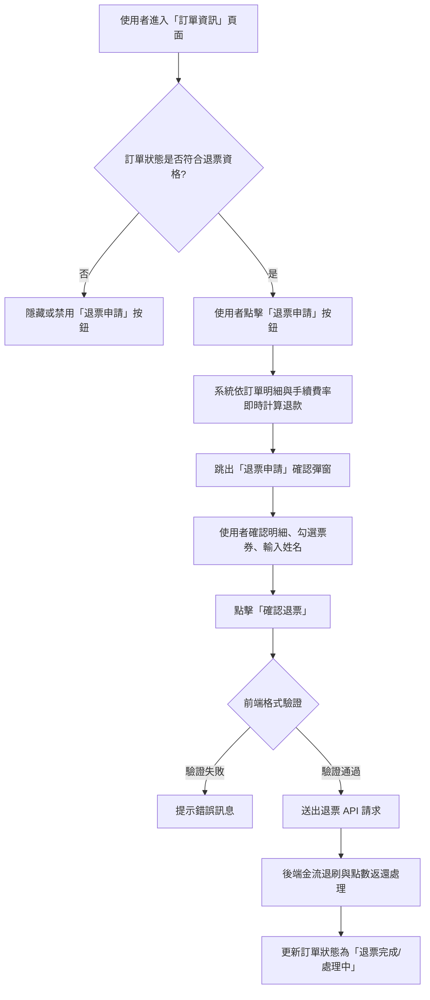
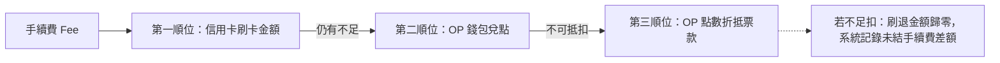

# 【PRD 產品需求規格書】前台訂單資訊 - 線上退票申請彈窗暨退款計算規格

| 文件版本 | V1.0 | 撰寫人 | 售票產品團隊 PM |
| :--- | :--- | :--- | :--- |
| **文件狀態** | 待評估 (Ready for Review) | 適用系統 | ibon 前台售票 / 訂單核心服務 / 金流清算服務 |
| **目標讀者** | 系統架構師、前後端工程師 (FE/BE)、QA 測試工程師 | 相關頁面 | `online_refund_ui.html` |

---

## 1. 需求背景與業務目的 (Background & Objective)
- **現狀問題**：消費者在訂單成立時，可能採用了複合式付款方式（如：折扣碼優惠、OP 點數直接折抵票款、OP 錢包兌點、信用卡差額付款）。現行退票缺乏標準化的前台即時試算揭露，容易造成退刷金額與返還點數爭議。
- **功能目的**：
  1. 提供消費者透明可信賴的退票試算明細，清楚標示手續費、現金刷退與點數返還。
  2. 建立精確的**扣款優先序瀑布流（Waterfall Deduction Model）**，統一金流與點數的扣減標準，降低客服客訴成本與帳務對帳差異。

---

## 2. 使用者流程圖 (User Flow)



---

## 3. UI 介面與欄位規格 (UI Specification)

### 3.1 彈窗觸發入口 (訂單主頁)
- **按鈕位置**：訂單明細區塊最下方。
- **按鈕樣式**：白底粉紅框按鈕，文字：「退票申請」。
- **觸發動作**：點擊後彈出退票申請 Modal，背景加入 50% 黑色半透明遮罩 (`rgba(0,0,0,0.5)`)。

### 3.2 彈窗結構與欄位清單 (Modal Layout)

| 區塊 | 欄位名稱 | 元件類型 | 規格說明 / 邏輯規則 |
| :--- | :--- | :--- | :--- |
| **標頭** | 標題 | 純文字 | 顯示「退票申請」，右上角附 `✕` 關閉按鈕。 |
| **明細區 (藍底卡片)** | 退票原因 | 純文字標籤 | 依手續費率判斷：<br>• 手續費 = 0 顯示 **`因雨退票`**（不可抗力免收）<br>• 手續費 > 0 顯示 **`因事退票`**（個人因素） |
| | 票價 | 金額顯示 | 顯示 `NT$ [modalPrice]`（票券原價總額）。 |
| | OP點數折抵票款 | 金額顯示 | 顯示 `NT$ [opTicketingVal]`（購票時直接折抵票款金額）。 |
| | 折扣 | 金額顯示 | 顯示 `NT$ [modalDiscount]`（折扣碼折抵金額）。 |
| | 分隔線 | UI 元素 | 淺藍色虛線/實線分隔。 |
| | **手續費** | 金額顯示 | 顯示 `NT$ [modalFee]`（系統計算之手續費）。 |
| | **刷退金額(含點數)** | 金額顯示 | 顯示 `NT$ [modalRefundCash]`（計算金額 = 票價 - OP點數折抵票款 - 折扣 - 手續費）。 |
| | **點數返回** | 金額/點數顯示 | 顯示 `NT$ [modalRefundPoints]`（OP點數折抵票款之金額返還）。 |
| **規則說明** | 退票手續費條款 | 純文字 | 「本活動委託 ibon 售票系統代為處理退款事宜，依退款規則辦理，並酌收票價 `[feeRate]%` 的退票手續費，逾期恕不受理。」 |
| **操作表單** | 勾選票券 | Checkbox | 顯示可退票之票號（如：`QXX2601060000541097P`），預設全選。若無勾選則禁用「確認退票」。 |
| | 退票人姓名 | Text Input | 必填文字框，預設帶入訂票人姓名，允許修改。若為空提示防呆。 |
| **確認操作** | 確認退票按鈕 | Button | 粉紅色填滿按鈕，點擊送出退票作業。 |

---

## 4. 業務運算邏輯與扣款優先序 (Business Logic & Calculation)

### 4.1 前置變數定義
- 票價總額：$P$ (`price`)
- 折扣金額：$D$ (`discount`)
- OP 點數折抵票款 (整筆取消類)：$T_{\text{op}}$ (`opTicketing`)
- 退票手續費率：$R_{\text{fee}}$ (`feeRate`，百分比)
- OP 錢包兌點金額：$W_{\text{op}}$ (`opWallet`)

### 4.2 基礎運算公式
1. **購票付款金額**：
   $$\text{總付款金額 } P_{\text{total}} = \max(0, P - T_{\text{op}} - D)$$
   $$\text{信用卡刷卡金額 } C = \max(0, P_{\text{total}} - W_{\text{op}})$$
2. **退票手續費公式**：
   $$\text{手續費 } F = \text{round}\left( P \times \frac{R_{\text{fee}}}{100} \right)$$
   > 備註：以「票面原價 $P$」為計費基準進行四捨五入。

### 4.3 扣款優先序瀑布流（Waterfall Deduction）
當退票產生手續費 $F$ 時，系統依以下嚴格順位進行抵扣：



#### 演算法虛擬代碼 (Pseudocode)：
```javascript
let feeRemaining = F; // 待扣手續費
let refundCash = C;   // 預計刷退金額初始值 = 刷卡金
let refundOpWallet = W_op; // 預計返還點數初始值 = 錢包兌點
let refundOpTicketing = T_op;

// 第一順位：扣除現金/信用卡金額
let deductCash = Math.min(feeRemaining, refundCash);
refundCash -= deductCash;
feeRemaining -= deductCash;

// 第二順位：扣除 OP 錢包兌點（點數返還減少）
let deductWallet = Math.min(feeRemaining, refundOpWallet);
refundOpWallet -= deductWallet;
feeRemaining -= deductWallet;

// 彈窗顯示賦值
modalRefundCash = Math.max(0, P - T_op - D) - F; // 刷退金額(含點數) = 票價 - OP點數折抵票款 - 折扣 - 手續費
modalRefundPoints = T_op;                        // 點數返回 = OP點數折抵票款之全額
```

---

## 5. 後端 API 規格與資料結構 (API Specification)

### 5.1 退票試算 API (Pre-calculation)
- **Endpoint**: `POST /api/v1/orders/{orderId}/refund-preview`
- **Request Payload**:
  ```json
  {
    "orderId": "E2609010181818",
    "ticketIds": ["QXX2601060000541097P"]
  }
  ```
- **Response Payload (200 OK)**:
  ```json
  {
    "success": true,
    "data": {
      "orderId": "E2609010181818",
      "refundReason": "因事退票",
      "feeRate": 10,
      "price": 100,
      "opTicketing": 20,
      "discount": 30,
      "fee": 10,
      "refundCash": 40,
      "refundPoints": 20
    }
  }
  ```

### 5.2 執行退票申請 API (Submit Refund)
- **Endpoint**: `POST /api/v1/orders/{orderId}/refund-submit`
- **Request Payload**:
  ```json
  {
    "orderId": "E2609010181818",
    "ticketIds": ["QXX2601060000541097P"],
    "applicantName": "王小明",
    "expectedRefundCash": 30,
    "expectedRefundPoints": 10
  }
  ```
- **Response Payload (200 OK)**:
  ```json
  {
    "success": true,
    "refundRequestId": "REF202610140001",
    "status": "PROCESSING",
    "message": "退票申請已受理，預計 7-14 個工作天完成刷退與點數返還。"
  }
  ```

---

## 6. 異常與邊界條件處理 (Edge Cases & Exception Handling)

1. **手續費高於實付金額（不足扣）**：
   - 範例：票價 1,000 元，折扣碼折 950 元，消費者實刷 50 元。手續費 10% 為 100 元。
   - 處置規範：刷退金額最低顯示為 `0 元`，不足扣之 50 元轉為消費者現場補繳款項或記錄於系統負項帳戶。
2. **點數已過期返還處理**：
   - 若返還之 OP 點數在退票時已超過原效期，由 OP 會員中台依展延機制處理或返還當月最後一天到期點數。
3. **重複送出防呆（Idempotency）**：
   - 前端點擊「確認退票」後按鈕呈現 Loading 狀態並禁用，防止連點。
   - 後端需實作 `Idempotency-Key`，重複請求回傳 `409 Conflict`。
4. **訂單退票時效性檢查**：
   - 逾期訂單（如演出當天或活動後），前端隱藏退票按鈕；若強行呼叫 API 回傳 `400 ERR_REFUND_EXPIRED`。

---

## 7. QA 驗收標準與測試矩陣 (Acceptance Criteria & Test Matrix)

| 測試案例編號 | 購票條件情境 | 預期手續費 | 預期刷退金額 | 預期點數返回 | 預期退票原因 |
| :--- | :--- | :--- | :--- | :--- | :--- |
| **TC-01** | 票價 100，手續費率 0% | 0 元 | 實刷金額全退 | 兌點全額退 | 因雨退票 |
| **TC-02** | 票價 100，折抵 20，折扣 30，實刷 50，手續費 10% | 10 元 | 40 元 | 0 點 | 因事退票 |
| **TC-03** | 票價 100，折抵 20，折扣 30，錢包兌點 10，實刷 40，手續費 10% | 10 元 | 30 元 | 10 點 | 因事退票 |
| **TC-04** | 實刷 5 元，手續費 10 元 (不足扣) | 10 元 | 0 元 | 不足扣警示 | 因事退票 |
